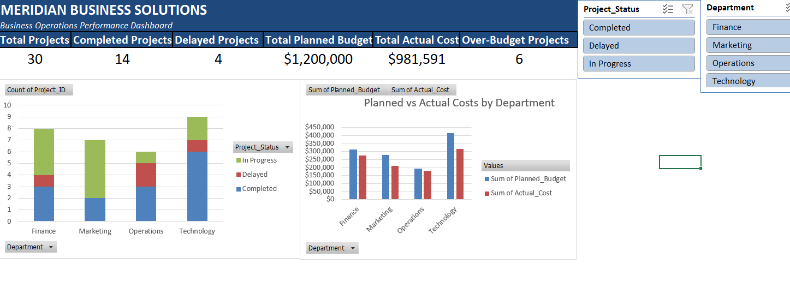

# Meridian Business Solutions — Business Operations Performance Analysis

## Project Overview
An Excel-based business operations analysis project using fictional consulting company data. The project examines project performance, department-level results, delays, and budget utilization.

## Tools & Skills
- Microsoft Excel
- Advanced Excel formulas: XLOOKUP, SUMIFS, COUNTIFS, IF, IFERROR, SUMPRODUCT, LET
- Dynamic array functions: FILTER, UNIQUE, SORTBY
- PivotTables and PivotCharts
- Interactive slicers
- KPI reporting and dashboard development

## Project Analysis
- Combined project and cost data to calculate actual costs and budget variances.
- Evaluated project status and budget performance.
- Compared project results across departments.
- Identified delayed projects and projects exceeding their planned budgets.

## Dashboard
The interactive dashboard summarizes key operational KPIs, project status, and planned versus actual costs by department.

## Key Findings
- 30 projects were included in the analysis.
- 14 projects were completed and 4 were delayed.
- Total planned budget was $1,200,000.
- Total actual cost was $981,591.
- 6 projects were over budget.
- Operations had the highest delay rate at 33.3%.

## Workbook Structure
- `Projects` — Original project records.
- `Project_Costs` — Project cost transactions.
- `Project_Analysis` — Project-level calculations and budget analysis.
- `Department_Analysis` — Department-level performance.
- `Delayed_Projects` — Dynamic list of delayed projects.
- `Project_Ranking` — Projects ranked by actual cost.
- `Pivot_Analysis` — PivotTables and supporting analysis.
- `Dashboard` — Interactive KPI dashboard.

## Project Dashboard

## Project Analysis

## Department Analysis

*Note: All company names and data used in this project are fictional and created for portfolio purposes.*
